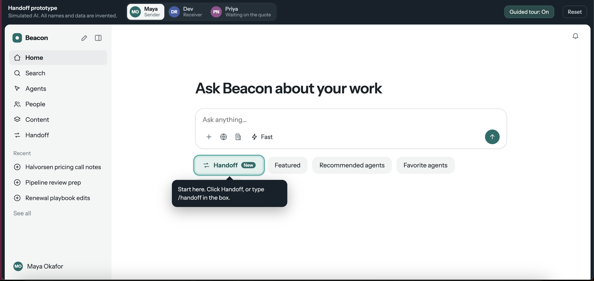
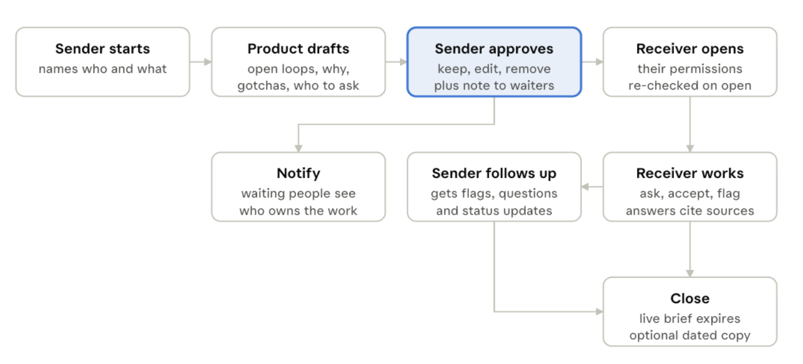
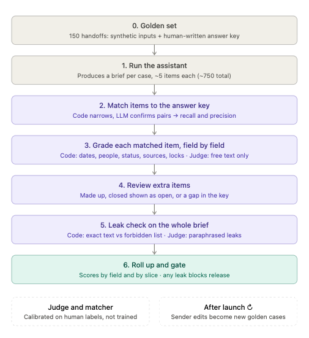

# Handoff: carrying context, not just documents, when work changes hands

An interactive prototype and product case study exploring how an enterprise AI assistant could help one person hand work to another without losing the context that never made it into a document.

**[Try the live prototype](https://chaudharys.github.io/workflow-handoff/)** (single HTML file, no build step)

*The prototype's home screen. The header switches between the three personas (Sender, Receiver and Waiting) so you can see the same handoff from each side. Leave **Guided tour** on and it walks you through all three experiences. All names and data are invented.*

## The problem

When work changes hands (leave, a role change, a reorg, a project moving teams), the receiver gets the documents but not the sender's context: why decisions were made, what was promised, which decisions are half-made, and who is waiting on what. That knowledge lives in the sender's private threads and in their head. The receiver rebuilds it by asking around, or misses it and drops a commitment.

Today a handoff is a doc or a meeting, written from memory and stitched together from email, chat, tickets and project docs. It is only as good as the sender's recall of their last busy week.

## Who it's for

| Who | Situation | What they need |
|---|---|---|
| **Sender** | The original owner, handing off work | Hand off quickly without recalling and rewriting everything by hand |
| **Receiver** | The new owner | To know what is live, what is promised, who is waiting, and why past calls were made |
| **Affected people** | Colleagues waiting on or collaborating on the work | Their commitments not dropped, and to be told who owns the work now |

## Why existing tools fall short

AI assistants inside a single suite or project can summarize what one person can see. None of them moves one person's open loops to another, with consent, across email, chat, tickets and docs. Doing that well takes three things:

- Access to both the individual's context and the company's context
- Permission checks at the moment of transfer, so the receiver never sees what they couldn't already open
- Reach across tools, not just one product

## Hypothesis

If an assistant combines personal and organizational context, a handoff brief can be produced much faster than a hand-written doc. With the receiver and affected people kept in the loop, fewer commitments get dropped, and there is less rework and chasing.

## The concept, briefly

1. The sender starts a handoff for a project to one named receiver.
2. The assistant drafts a brief of open loops. Each one carries the why, who is waiting, who to ask, its sources, and a confidence level.
3. The sender reviews every item: keep, edit or remove. Items the receiver can't access are flagged first.
4. The receiver works from the brief under their own permissions, then accepts, sends back or flags each item.
5. People waiting on the work get a sender-approved note saying who now owns it.

## Key design decision: draft, then approve

The assistant could assemble and send a brief on its own. I chose draft-then-approve instead, because one wrong item reaching a colleague costs more trust than a few minutes of review saves. Autonomy should be earned: loosen the review step only once draft accuracy and sender completion hold up.

Principle throughout: the assistant finds and drafts, but never decides who sees what. Every output cites its sources, shows its confidence, and is logged.

## How I'd know it works

- **North star:** share of handoffs that are reviewed, released, and accepted by the receiver within a week
- **Quality:** how often senders remove drafted items; how many items receivers accept
- **Reach:** how often the people affected open their note
- **Guardrails:** no cannibalization of the assistant's other flows; very few senders revoking a brief or turning the feature off
- **Evaluation:** a synthetic "golden set" of handoffs with answer keys, including hard cases like restricted channels, loops closed in later threads, and conflicting dates

*How the evaluation works: code handles the checkable fields, an LLM judge handles only free text, and any permission leak blocks a release. Sender edits after launch become new golden cases.*

## What could come next

- Lower sender effort: one-click approval and assistant-suggested handoffs when it spots a trigger (leave on the calendar, a role change)
- Wider multiplayer: team-level handoffs, new-teammate onboarding briefs, and cross-team routing of dependencies

## About this project

A prototype built to explore the problem space. The HTML file uses sample data only.
